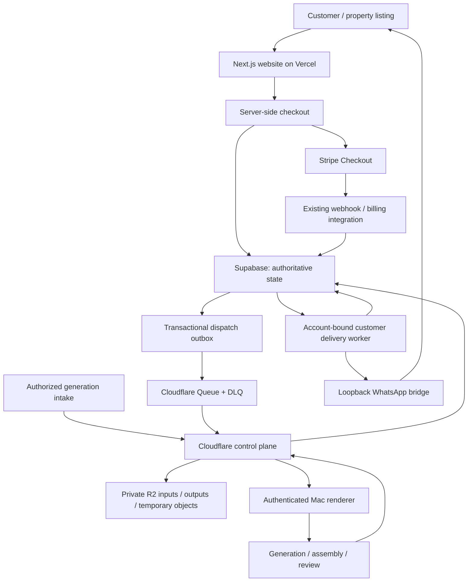

# Recorrido

**A WhatsApp-first workflow for turning property-listing photography into video, with billing controls, private generation jobs and recoverable customer delivery.**

[Website](https://www.getrecorrido.com/en) · [Engineering case study](https://projects.kedolabs.com/case-studies/recorrido.html) · [Cloudflare control-plane documentation](cloudflare/generation-control-plane/README.md)

Built by **Kofi (Ephraim) Owusu / Kedolabs**.

## Contents

- [What Recorrido does](#what-recorrido-does)
- [Repository scope](#repository-scope)
- [Architecture](#architecture)
- [Workflow walkthrough](#workflow-walkthrough)
- [Run the website locally](#run-the-website-locally)
- [Configuration](#configuration)
- [Database and billing prerequisites](#database-and-billing-prerequisites)
- [Generation and delivery workers](#generation-and-delivery-workers)
- [API boundaries](#api-boundaries)
- [Testing](#testing)
- [Deployment and rollback](#deployment-and-rollback)
- [Operating costs](#operating-costs)
- [Limitations and troubleshooting](#limitations-and-troubleshooting)
- [Repository map](#repository-map)

## What Recorrido does

Recorrido connects the customer-facing property-media experience to an operational workflow:

1. Explain the service and plans in Spanish, Portuguese or English.
2. Prepare an authoritative checkout and send the customer to Stripe.
3. Coordinate an account-bound generation request and reserve its entitlement.
4. Store private inputs, dispatch work and lease generation to an authorized renderer.
5. Produce and review a video from the supplied property assets.
6. Deliver the authorized output through an account-bound WhatsApp bridge.
7. Settle the generation and send a separate remaining-balance notice.

The difficult part is maintaining the relationship between the account, listing, reserved generation, output and recipient when external services fail halfway through the workflow.

## Repository scope

This repository contains:

- The Next.js marketing website and localized purchase/legal/opt-out routes.
- Server-side Stripe Checkout preparation and finalization.
- Supabase migrations for checkout onboarding, generation coordination and customer delivery.
- A Cloudflare Worker, private R2 bindings, Queues, dead-letter queues and scheduled dispatch recovery.
- Python adapters for the existing Mac renderer and WhatsApp delivery bridge.
- Unit, browser, worker and database-behavior test sources.

**A fresh clone can run the website, but cannot operate the complete paid generation service by itself.** The existing billing-core schema, Stripe webhook/entitlement provisioning, renderer scripts, provider credentials and authenticated WhatsApp bridge are integration prerequisites. The local generation adapter refers to an operator-specific renderer path and scripts that are not included in this checkout.

The wider generation workflow uses Grok Imagine through fal.ai, media assembly and visual review. Those production dependencies are not installed by the root `npm ci` command.

## Architecture



### Responsibilities

| Component | Responsibility |
| --- | --- |
| Next.js / Vercel | Public pages, checkout API and opt-out proxy |
| Stripe | Payment/subscription session and external payment processing |
| Supabase | Account/member binding, billing, reservations, jobs, leases, settlement and dispatch state |
| Cloudflare Worker | Authenticated object/job ingress, lease endpoints, queue handling and recovery |
| R2 | Private immutable inputs and lease-fenced output objects |
| Cloudflare Queue / DLQ | Bounded dispatch attempts and exhausted-message handling |
| Mac renderer | Existing generation and assembly computation |
| Delivery worker / bridge | Sender verification, provider-confirmed media acceptance and separate notice acceptance |

Cloudflare is the control plane in this implementation; the committed renderer adapter performs compute on a Mac. The migration does not move the website, billing authority, WhatsApp session or DNS to Cloudflare.

## Workflow walkthrough

### 1. The customer selects a plan

The public site supports `/es`, `/pt` and `/en`. Localized routes include privacy, terms, refunds, purchase success/cancellation and opt-out pages.

The current source catalog is:

| Plan | Canonical USD price | Generations | Members |
| --- | --- | --- | --- |
| Single listing | $22 once | 1 | 1 |
| Pro monthly | $32/month | 4 | 1 |
| Pro annual | $320/year | 4 | 1 |
| Agency monthly | $79/month | 12 | 3 |
| Agency annual | $790/year | 12 | 3 |

These are the values in [`src/lib/site/catalog.ts`](src/lib/site/catalog.ts), not a promise that a deployed environment uses identical catalog configuration. Annual billing does not mean all listed generations are granted once for the entire year; consult the authoritative billing rules for allocation cadence.

### 2. The server prepares checkout

The browser submits checkout details to `POST /api/checkout`.

The server validates and normalizes the request, applies a request-rate limit and asks the Supabase checkout store to prepare the purchase. It validates the returned account/member IDs, canonical product, Stripe price, session mode, amount, currency and normalized WhatsApp phone before creating a Stripe session.

Success and cancellation URLs are derived from the configured site origin. A browser-supplied price or arbitrary return URL is not the authority for the purchase.

An already-created valid checkout can be reused. New sessions are finalized through the store before their approved Stripe URL is returned. Invalid input produces an error; unavailable authority/configuration fails closed with `checkout_unavailable`.

### 3. Payment becomes an entitlement

The existing billing/webhook integration reconciles Stripe events into the Supabase account and entitlement state. A purchase-success page is presentation, not evidence that payment has been reconciled or credits granted.

This repository contains checkout integration and dependent migrations, not a standalone replacement for that existing billing deployment. See the [billing design](docs/superpowers/specs/2026-08-04-recorrido-billing-approval-design.md).

### 4. An authorized request becomes a generation job

The account-bound intake supplies the listing/assets and generation intent. The Worker accepts authenticated inputs and prepares the job through authoritative database operations.

Input objects are create-only. Manifest uploads compute SHA-256 and attach the digest to private object metadata. The expected namespace binds the account and idempotency key, so a replay cannot silently replace an established manifest.

Supabase retains reservation, job and outbox authority. Storing a file in R2 is not sufficient permission to generate or deliver it.

### 5. Dispatch survives partial failures

A transactional outbox records the dispatch intent. The Cloudflare Queue transports work, with bounded retries and a separate DLQ. A cron trigger recovers outstanding outbox dispatches.

Terminal/dead dispatches are finalized rather than repeatedly re-enqueued. Generation activation is independently controlled in Supabase and defaults to `off`.

### 6. The renderer claims a fenced lease

The local renderer polls the authenticated lease endpoint, downloads the private manifest/assets and runs the existing generation/assembly tooling.

Supabase issues an opaque lease token and monotonic lease version. Heartbeats, output uploads, completion and failure must present the environment, worker identity, token and version.

Outputs are fenced under:

```text
accounts/<account>/jobs/<job>/leases/<lease_token>/output.mp4
```

A stale renderer cannot overwrite the active lease's output. The adapter supports bounded input/output sizes and multipart output upload where needed.

### 7. Media is generated, assembled and reviewed

The wider production workflow prepares listing imagery, generates motion, assembles scenes and checks the resulting media. Visual review and approval must apply to the actual output, not merely a listing ID or a previous preview.

The public control-plane adapter integrates with existing V16 renderer scripts. This checkout includes a motion-QA utility and tests, but does not include every generation, semantic-review or manual-approval implementation used by the wider runtime. See the [WhatsApp workflow design](docs/superpowers/specs/2026-08-02-recorrido-whatsapp-design.md) for that broader context.

### 8. Render completion stages customer delivery

The customer-delivery migration binds the account, member, reservation, listing, output format, recipient, output object/hash and expected sender identity. The caller does not select an arbitrary delivery recipient.

Render completion creates one delivery outbox row while the generation reservation remains reserved. The delivery worker claims the row and verifies the loopback bridge's account identity before checkpointing the send.

### 9. Media acceptance settles the generation

Provider-confirmed media acceptance records the provider message ID, consumes the reservation once, rereads the committed balance and stages the remaining-generation notice.

A journaled provider message ID allows a retry of the database acknowledgement without another WhatsApp send.

### 10. The balance notice is a separate operation

The Spanish or Portuguese remaining-generation notice has its own lease and provider ID. Notice failure does not resend the video or refund an already-delivered generation.

### Recovery behavior

| Failure | Intended recovery boundary |
| --- | --- |
| Bridge/sender failure before send checkpoint | Abandon the claim for retry without settlement |
| Crash/timeout after checkpoint, no provider ID | Retain ambiguous state; do not automatically resend |
| Provider ID journaled, database acknowledgement fails | Retry acknowledgement only |
| Remaining-balance notice fails | Retry notice independently of media |
| Expired `media_claimed` / `notice_claimed` lease | Reclaimable |
| `media_sending` / `notice_sending` state | Not automatically reclaimable |
| Stale renderer lease | Reject stale writes/completion |

These are explicit recovery controls, not a claim of universal exactly-once delivery across external systems. An ambiguous send needs reconciliation before further action.

## Run the website locally

Use Node.js 22 and npm for the documented development path.

```sh
git clone https://github.com/kofiowusuai-lab/recorrido.git
cd recorrido
npm ci
cp .env.example .env.local
npm run dev
```

Open `http://localhost:3000/en`, `/es` or `/pt`.

Replace placeholder configuration before testing checkout. The public marketing pages do not establish that Stripe, billing, generation or customer delivery is configured.

For a production-style local build:

```sh
npm run build
npm start
```

## Configuration

### Website server

| Variable | Purpose |
| --- | --- |
| `NEXT_PUBLIC_SITE_URL` | Canonical origin for metadata and server-derived checkout returns |
| `SUPABASE_URL` | Supabase project URL |
| `SUPABASE_SERVICE_ROLE_KEY` | Server-only database authority |
| `STRIPE_SECRET_KEY` | Server-only Stripe credential; use test mode for development |
| `RECORRIDO_OPTOUT_EDGE_URL` | Optional HTTPS endpoint ending in `/functions/v1/recorrido-outreach-optout` |

The opt-out endpoint is present in code but is not listed in the current `.env.example`. Without a valid configured upstream, opt-out requests fail closed. The opt-out page parses a fragment token; the API validates its limited request shape and does not accept arbitrary upstream URLs.

Never expose service-role keys or Stripe secrets through `NEXT_PUBLIC_` variables.

### Cloudflare Worker

Runtime secrets are named in the [control-plane README](cloudflare/generation-control-plane/README.md): `INGRESS_API_TOKEN`, `LOCAL_WORKER_TOKEN`, `SUPABASE_URL`, `SUPABASE_SERVICE_ROLE_KEY` and optional `ALERT_WEBHOOK_URL`.

Configure them through Cloudflare's secret mechanism. Production and staging have separate Queue/DLQ and R2 bindings in [`wrangler.jsonc`](cloudflare/generation-control-plane/wrangler.jsonc).

### Local adapters

The protected configuration file defaults to:

```text
~/.config/recorrido/cloudflare-generation.env
```

Generation configuration includes `WORKER_URL`, `LOCAL_WORKER_TOKEN` and `WORKER_ID`. Delivery additionally uses the configured loopback bridge, including `RECORRIDO_WHATSAPP_BRIDGE_URL` where supplied. Read the adapters for their compatibility aliases and validation.

Do not put real credentials into this README, command examples, Git or logs.

## Database and billing prerequisites

Migrations are under [`supabase/migrations`](supabase/migrations). They extend an existing Recorrido billing/account schema; they are not a complete bootstrap for an empty database.

Before applying them:

1. Establish the billing-core predecessor schema and required roles/functions.
2. Map the actual Stripe prices and products to the authoritative catalog.
3. Confirm webhook reconciliation and account/member binding.
4. Apply dependent migrations in their intended order in an isolated staging database.
5. Verify generation/delivery runtime controls remain off until the complete integration is ready.

The PostgreSQL behavior harness references the external `202608040001_recorrido_billing_core.sql` predecessor and operator-specific paths. It also recreates disposable temporary database directories. Inspect and adapt it for an isolated test environment; it is not a ready-to-run production migration command.

## Generation and delivery workers

Install the control-plane development dependencies separately:

```sh
cd cloudflare/generation-control-plane
npm ci
npm test
npm run typecheck
```

Python adapter checks can be run with a Python 3.12 environment containing pytest:

```sh
python3.12 -m pytest -q tests
```

The generation adapter explicitly requires macOS and trusted external renderer scripts. Its configured repository path is operator-specific. Do not assume cloning this repository installs a portable renderer.

After the protected configuration, external renderer and staging authority are ready, one-shot worker commands are:

```sh
python3.12 local/worker.py --once
python3.12 local/delivery_worker.py --once
```

These are operational commands: with active runtime/configuration, they can claim work, produce media or send a real message. They are not dry-run tests.

The LaunchAgent installers support installing without activation. See the control-plane README before enabling them. Runtime environment switching goes through `local/runtime_control.py`; it locks the singleton control row and refuses unsafe switches while work/outbox entries remain.

## API boundaries

| Surface | Purpose |
| --- | --- |
| Website `POST /api/checkout` | Validate, prepare and finalize Stripe Checkout |
| Website `POST /api/opt-out` | Validate and proxy an opt-out request |
| Worker `GET /health` | Component/environment/release health metadata |
| Worker `/v1/objects/input` | Authenticated private input upload/download |
| Worker `POST /v1/jobs` | Authorized generation-job preparation |
| Worker `POST /v1/leases/next` | Claim generation work |
| Worker `/v1/jobs/:id/...` | Heartbeat, output upload/finalization, completion and failure |
| Worker `POST /v1/deliveries/next` | Claim server-bound delivery work |
| Worker `/v1/deliveries/:id/...` | Delivery lease, checkpoint, media and acknowledgement operations |

Ingress and local-worker credentials have separate roles. Inspect [`src/index.ts`](cloudflare/generation-control-plane/src/index.ts) for exact methods, payloads and checks. A healthy `/health` response alone does not prove that billing, rendering or delivery is operational.

## Testing

From the repository root:

```sh
npm run test
npm run typecheck
npm run lint
```

Root unit tests cover checkout authority, validation, Stripe integration boundaries, opt-out behavior, localized pricing, assets and site contracts.

Browser tests:

```sh
npx playwright install chromium
npm run test:e2e
```

The Playwright configuration builds and starts the site at port `3100` and defines viewport projects from 320px to 1440px.

Control-plane TypeScript and Python tests are separate from the root suite. They exercise lease fences, object/job contracts, dispatch recovery, local worker behavior, canary fixtures and delivery handling. The PostgreSQL harness tests real database behavior after its external prerequisites are supplied.

Test commands are reproduction instructions, not a claim that every suite passed during this documentation change. The [portfolio engineering notes](https://projects.kedolabs.com/evidence/recorrido-tests.html) also describe an older, separate local delivery test selection with two balance-notice assertions requiring reconciliation. Do not treat that selection as the result of this repository's current control-plane suite.

## Deployment and rollback

### Website

Build the Next.js application and configure its server-only values on Vercel. Set `NEXT_PUBLIC_SITE_URL` to the intended canonical origin before publishing. Verify all locales, checkout returns and opt-out configuration on the target deployment.

### Control plane

From `cloudflare/generation-control-plane`, after provisioning the required staging resources and secrets:

```sh
npm run deploy:staging
npx wrangler deployments list --env staging
```

Keep runtime activation off until database contracts, renderer and sender identity are verified. Production publication is a separate operational step:

```sh
npm run deploy:production
npx wrangler deployments list
```

Publishing code does not itself authorize billable jobs or customer delivery. Supabase runtime flags govern activation independently.

### Rollback

Follow [`ROLLBACK.md`](cloudflare/generation-control-plane/ROLLBACK.md): drain/reconcile outstanding work, turn runtime dispatch off through the guarded control command, stop only the relevant adapter, then roll back to a known-good Worker version. Preserve ledger rows, private objects, queues and provider evidence needed for reconciliation.

## Operating costs

Builder-reported operating context:

- Generation through Grok Imagine via fal.ai: approximately **$1.20 per video**.
- Current reported Supabase spend: **$0**.
- Current reported Remotion spend in the wider media workflow: **$0**.
- Separate Google Cloud container usage was reported as negligible per video at the stated workload, with a **$30–50** higher-volume infrastructure estimate. Its billing period and workload assumptions were not specified.

The Google Cloud estimate is operating context, not the architecture implemented by the committed Mac renderer adapter. These figures are not a fully loaded delivered-video cost: retries, storage, transport, compute and other services can affect totals. Reported zero spend is not a blanket licensing or free-at-scale guarantee.

## Limitations and troubleshooting

| Symptom | First checks |
| --- | --- |
| Checkout unavailable | Server credentials, canonical HTTPS origin, required RPCs and catalog authority |
| Opt-out unavailable | Configured Edge Function URL, supported token/locale shape and upstream response |
| No generation work claimed | Runtime flag/environment, dispatch/outbox state and worker credentials |
| Renderer refuses startup | macOS, configured trusted renderer paths and protected configuration |
| Output/completion rejected | Current account/job binding, lease token/version and output namespace/hash |
| Delivery refuses sender | Bridge health and expected account identity |
| Media stuck in sending state | Reconcile provider/journal evidence; do not blindly resend |
| Video delivered but balance notice failed | Notice lease and acknowledgement state; retain successful media settlement |

Other boundaries:

- This is not a complete open-source deployment of every provider, webhook, renderer or authenticated desktop integration.
- Runtime state and production activation must be verified against the actual environment; source presence is not proof of live operation.
- Review controls do not establish measured model accuracy, property fidelity or a false-acceptance rate.
- Do not replace architecture-specific recovery with an unconditional retry loop.

## Repository map

```text
src/app/                         Next.js pages and API routes
src/components/                  Marketing, checkout and opt-out interfaces
src/lib/site/                    Locales, route slugs, assets and pricing catalog
src/lib/checkout/                Validation, authoritative store and Stripe flow
supabase/migrations/             Dependent checkout/generation/delivery migrations
cloudflare/generation-control-plane/
  src/index.ts                   Worker HTTP, queue and scheduled handlers
  local/                         Mac generation/delivery adapters and runtime tools
  tests/                         Worker, Python and PostgreSQL behavior checks
  wrangler.jsonc                 Explicit production/staging bindings
scripts/                         Published motion-QA utility
public/                          Site assets
tests/unit/                      Website and checkout unit tests
tests/e2e/                       Responsive browser tests
docs/                            Design records, plans and asset manifest
```

Start with the [control-plane README](cloudflare/generation-control-plane/README.md), [migration scope](cloudflare/generation-control-plane/MIGRATION_SCOPE.md), [billing design](docs/superpowers/specs/2026-08-04-recorrido-billing-approval-design.md) and [website design](docs/superpowers/specs/2026-08-11-recorrido-website-design.md) for deeper implementation context.
